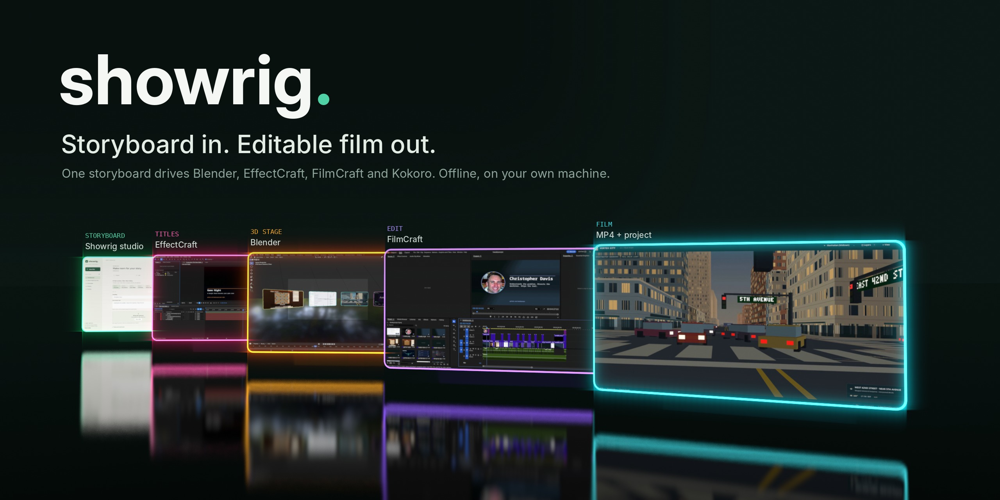

# Showrig



**An offline procedural film studio. Make a video in your local browser. Keep the editable FilmCraft project.**

Showrig 0.3.0a1 keeps the navigable film library, 14 scene-structure templates, six visual looks,
recoverable film-history cleanup, and the platform-aware Setup & extras page, and adds a guided editor
that builds a film from plain prompts, an extension-pack system with a starter pack, and bundled 3D
stage samples you can drop straight into a template. There are no accounts or hosted rendering
services. Python and native tools run on your computer; the browser is the control room. Templates,
looks and stages are hand-made rather than generated: the same storyboard renders the same film every
time, with AI strictly optional.
The [tweakyourpc promo](examples/tweakyourpc-promo) was built with the same procedural pipeline, and
the [v0.3.0a1 release](https://github.com/tweakyourpc/showrig/releases/tag/v0.3.0a1) ships a 2:52 film
made by Showrig pitching itself: staged, titled, narrated and rendered offline, delivered as both an
MP4 and an editable FilmCraft project.

Showrig asks the questions a director and producer would answer: what kind of film, what it should
look like, who speaks, what plays underneath. You bring footage, recordings and music, or let Showrig
record web pages and generate them. It writes a storyboard for you to sign off. From there everything
is procedural:

| Step | Tool | Result |
|---|---|---|
| Footage | FFmpeg; headless Chromium on the GPU for scripted page recordings (typing, clicks, eased scrolls) | every shot at the film's size and frame rate |
| Voice | Kokoro-82M offline text to speech, or your own WAVs | levelled voice lines |
| Plan | Showrig | a frame-exact edit: each scene as long as its narration needs |
| 3D showcase | Blender EEVEE | your footage on floating, glowing screens: an opening arc, one establishing shot per segment, a closing wall |
| Titles | EffectCraft (ArtCraft) | title cards (rise or typewriter) and rolling credits, with alpha, each one an editable `.ecproj` |
| Music | Showrig's synthesizer, or your track | a score cut to length, ducked under the voice |
| Edit | FilmCraft (ArtCraft) | an editable `.fcproj`: picture, titles, notes, voice, music, captions |
| Render | FilmCraft, NVENC when there is a GPU | `.mp4` and `.srt` |

Nothing is uploaded. An optional AI pass (`showrig draft`) uses a local model through Ollama to suggest
narration before the offline build. It only fills empty fields, and you review what it wrote.

## Quick start

### Browser studio

```sh
pip install -e .
showrig web
```

This opens the offline studio with **Film library**, **Templates**, **Extensions**, and
**Setup & extras** navigation. A guided view makes a first film conversational: answer each scene's
prompts, fill its media slots (upload your own pictures and clips, or point a slot at a local page and
let Showrig screenshot it), check the readiness list, and render. The full editor keeps its five steps:
**Purpose → Look → Story → Sound → Export**.
Choose a demo, showcase, announcement, explainer, tutorial, comparison, case study, event invitation,
event recap, social short, photo story, interview highlight, mini lesson, or blank canvas; then
write your scenes and optionally add images, video clips, music, or recordings.
The studio saves your work as you go. Reorder or duplicate scenes, render a half-size
preview, and export a full-size MP4, editable FilmCraft project, and optional SRT captions.
Download the editable ZIP to keep imported and generated media with the timeline. Extract the whole
folder and run its included `PREPARE-EDIT.py` helper before opening the project in FilmCraft; this
binds packaged media to its new location without changing the original film or your timeline edits.

Generated narration sits in the project as ordinary WAV files on the Voice track: plan your script with
the offline voice, then swap any of those WAVs for your own recording and keep the rest of the cut.
Captions keep coming from the written lines, so the swap never desyncs them.

Search and sort your films, bulk archive finished projects, or move films to Trash. Restore them at
any time, or explicitly confirm permanent deletion from Trash. This upgrade does not clean up or
delete any existing film automatically.

The **Extensions** page lists packs of optional content and integrations, with a starter pack ready to
load and per-piece readiness checks that show exactly what each pack unlocks on this machine. Bundled
3D stage samples (`showrig/samples/`) give the Blender showcase real footage before you add your own.

Use **Clear** beside **RECENT FILMS** to clear this browser's recent list while keeping all films in
the library. The cleared list persists across reloads. Opening or creating a film adds it back to
Recent; simply refreshing the current editor does not. Recent history is stored in this browser.

Text alone is enough to make a film. New films use content-based timing and 1080p at
30 fps, with 2D titles and procedural music. Portrait and square layouts are available.
Uploaded clip audio is omitted; add narration and music in the Sound step. Images
start at zero; use the scene's minimum duration to keep them on screen longer.

All fonts, interface files, media processing, and music generation are local. The
normal workflow needs FFmpeg, ffprobe, FilmCraft, and EffectCraft. Blender is optional
for landscape 3D scenes. Kokoro speech is optional and is only enabled after a real
offline synthesis check for the selected voice. Models are never downloaded during
production; configure a prepared environment with `SHOWRIG_TTS_PYTHON`, or explicitly run
`showrig setup --install-voices` to prepare an isolated voice environment and models. Preview its
actions first with `showrig setup --install-voices --dry-run`. These setup downloads are separate
from creating films. Voice installation and native libraries differ between operating systems.

See [Local setup and offline distribution](docs/LOCAL-SETUP.md) for Linux/macOS shell launchers,
Windows PowerShell launchers, optional voices and 3D/capture tools, and preparing platform-specific
offline prerequisite kits. Browser fonts and procedural title/music assets are bundled; native
FilmCraft, EffectCraft, FFmpeg and voice binaries/models are not in this source checkout. Windows
and macOS installation branches still need verification on their actual hosts.

On a host with `portbroker`, the launcher obtains its port from the broker and binds to `0.0.0.0`, so another
device on your LAN can use the studio. If running under a process manager, or when
the broker must run separately:

```sh
PORT=$(portbroker get --name showrig || portbroker alloc --name showrig)
showrig web --port "$PORT" --no-open
```

Standalone machines without portbroker use an OS-assigned free port, retained as a bound socket.
The launcher prints and opens the actual URL rather than assuming a default port.

Use `showrig web --projects /path/to/films` for a different film library. Existing
films in that folder appear automatically. Media outside the library or its sibling
`examples/` folder must be uploaded before the web studio can render it. Web captures
from legacy projects accept local HTML files only and block external requests.

Render jobs continue when you close the browser tab. Only one film renders at a time;
editing that film is paused until it finishes or you cancel. Closing the server cancels
its active render. Failed and cancelled jobs keep your last successful output.

The web studio stores immutable render workspaces under `work/builds/`, job logs under
the library's `.jobs/`, and successful export manifests under `out/`. Unchanged inputs
reuse their workspace. Each successful editable project refers to its retained build
assets, so keep `work/builds/` while using those projects. The MP4 and SRT are standalone.

### Terminal workflow

```sh
pip install -e .
showrig doctor                       # what's installed, and what each tool unlocks
showrig new films/launch             # the wizard
showrig draft films/launch           # optional: local model suggests missing narration
showrig make films/launch --draft    # fast first look
showrig make films/launch            # final quality; only changed pieces rebuild
```

Try the bundled example, which records two web pages and needs no footage of your own:

```sh
showrig new films/demo --answers examples/demo/answers.json
showrig make films/demo --draft
```

## A film folder

```
films/launch/
  showrig.json     the storyboard: every wizard answer; edit it by hand any time
  STORYBOARD.md    the same, readable, for sign-off
  assets/          your clips, recordings and music
  work/            generated pieces, rebuilt only when their inputs change
  out/             launch.fcproj, launch.mp4, launch.srt, versions/
```

Change a line of narration and `make` re-voices that line and recuts. Swap a clip and only that clip,
the 3D shots showing it, and the edit are redone. Previous FilmCraft projects are kept in
`out/versions/`.

## Post-production

The FilmCraft project is a normal project: open it, change anything, then `showrig render` to export
it again. Post modules work on that project in place, so hand edits survive:

```sh
showrig credits films/launch --line "Directed by=Your Name" --line "Music=Showrig score"
showrig render films/launch
```

## Edit it, then run it again

The project is the deliverable and the MP4 is a copy that can always be rendered again. Every clip in the
FilmCraft project is named `<beat id> · <label>` (`clip/shot1 · clip.mp4`, `intro/title · Launch`), coloured by
kind, on tracks named by role (Picture, Titles, Overlays, Voice, Music, Captions), with a marker across each
scene. `out/` also holds `manifest.json` (every beat, its frames and source hash), the same cut as `.otio` and
`.fcpxml` for other editors, `sources.lock` (every source and its licence) and `qc-report.json`.

What is editable: the timeline (cut, timing, clips, voice, music, captions) and the titles (EffectCraft
projects). The 3D stage, browser captures, backdrops and generated speech and score are compiled: Showrig makes
them again from the storyboard. The marker at frame 0 of every project says so.

Edit the project in FilmCraft (or let an agent edit it), then:

```sh
showrig diff films/launch          # what you changed since the build: moved, trimmed, deleted, relabelled...
showrig make films/launch          # re-run: your edits stay, untouched beats follow the storyboard
showrig lock films/launch clip     # freeze a beat (clip/title) or a whole scene (clip): never regenerated
showrig unlock films/launch clip   # hand it back to Showrig
showrig make films/launch --fresh  # start the project over (the old one goes to out/versions/)
```

`make` keeps every beat you changed, keeps what you deleted deleted (`--restore ID` brings one back), refreshes
and retimes the beats you did not touch, and never moves anything onto a clip of yours: where the storyboard and
your edit disagree it adds a magenta CONFLICT marker instead, and lists every decision in
`out/reconcile-report.json`. Keep the id at the front of a clip's name when you rename it.

Rights and checks. Supplied media carry `"provenance": {"licence": ..., "credit": ..., "url": ...}`;
`showrig sources FILM` lists them and `showrig sources FILM set REF --licence NAME` records one. In a new film a
source without a licence blocks the final render (drafts still build). After rendering, Showrig transcribes the
film again and checks that every narration line is heard (`showrig qc FILM`), so a word lost under the music is
caught; it needs a transcriber (`whisper-ctranslate2`, or any command set in `SHOWRIG_ASR`).

## Storyboard reference

```jsonc
{
  "title": "Launch",
  "kind": "showreel",                       // showreel | demo | explainer | trailer
  "format": {"width": 1920, "height": 1080, "fps": 60},
  "style": {
    "accent": "#46d9b0", "background": "#070b14",
    "titles": "rise",                       // rise | typewriter | none
    "transitions": "cinematic",             // cinematic | simple | cuts
    "pushIn": 6,                            // % slow zoom across each footage shot
    "showcase3d": true,                     // Blender stage
    "quality": "final"                      // final | draft
  },
  "voice": {"source": "tts", "voice": "af_heart", "say": {"OKLCH": "O K L C H"}},   // tts | files | none
  "music": {"source": "procedural", "mood": "bright"},                              // procedural | file | none
  "captions": {"mode": "burn"},                                                     // burn | srt | none
  "scenes": [
    {"kind": "intro", "title": "Launch", "tagline": "...", "lines": ["..."]},
    {"kind": "segment", "title": "Feature", "tagline": "...", "subtitle": "example.com",
     "shots": [{"file": "assets/feature.mp4", "in": 1.5, "weight": 2},
               {"capture": {"url": "https://example.com", "scale": 1.25,
                            "actions": ["wait 1", "type #search showrig", "press Enter", "scroll 1200 5"]}}],
     "lines": ["..."], "note": "Demo data"},
    {"kind": "card", "title": "Chapter two", "lines": ["..."]},
    {"kind": "outro", "title": "Launch", "lines": ["..."]}
  ],
  "credits": {"enabled": false, "lines": [["Directed by", "..."]]}
}
```

With `"voice": {"source": "files"}`, each scene gives one recording per line in `"voice": [...]`; the
lines' text still drives the captions.

## Configuration

Tools are found on `PATH` and in `~/Work/ArtCraft`. Override with `FILMCRAFT_CLI`, `EFFECTCRAFT_CLI`,
`BLENDER`, `NODE`, `SHOWRIG_PLAYWRIGHT`, `SHOWRIG_TTS_PYTHON` (a Python with `kokoro` installed),
`ARTCRAFT_HOME` and `OLLAMA_HOST`.

The studio drives your installed apps rather than any cloud service: FilmCraft and EffectCraft through
their ArtCraft command-line and MCP bridges, Blender headless through its Python driver, Chromium
through Playwright. The same wiring runs on Windows, Mac, or Linux hosts; the Setup & extras page
states what each platform still needs.

## Status

0.3.0a1, the studio-next alpha: guided editor, extension packs and bundled samples join the unchanged
procedural pipeline. Known limits:

- The 3D showcase is framed for landscape films.
- EffectCraft does not render text-animator range selectors yet, so titles animate whole lines
  (the typewriter style keys the text itself).
- Only one post module so far (credits).
- The guided view and extension packs are new; the five-step editor remains the complete path.

## Extending and checking the studio

Wizard templates and look presets live in `showrig/studio.py`; the browser reads their
catalog rather than keeping a second list. The responsive title renderer is
`showrig/assets/studio-title.jsx`. Existing CLI storyboards keep their original timing
unless they opt into `"timing": "content"`. An optional scene `duration` sets a minimum,
never a cutoff for narration. `style.design` selects the new title treatment.

Run the fast checks with `workspace-quality-gate` or:

```sh
pip install -e '.[test]'
python3 -m unittest discover -s tests
node --check showrig/static/app.js
```

Run real render integration tests with `SHOWRIG_RENDER_TESTS=1 python3 -m unittest tests.test_render -v`.
They create explicitly synthetic fixtures in `/tmp`, exercise three formats, uploads,
recorded audio, captions, failed exports, and cancellation, and print the artifact folder.

For browser verification, start a separate test library with
`showrig web --projects /tmp/showrig-browser-tests/films --no-open`, then run
`node scripts/browser-check.mjs`. It uses the broker reservation, blocks outside
requests, and saves desktop/mobile screenshots in `/tmp/showrig-browser-check`.
It requires locally installed Playwright and Chromium. Set `SHOWRIG_PLAYWRIGHT` if the
package is outside the global npm directory. The browser checks need an execution
environment that permits Chromium and local network connections.

`scripts/studio-check.mjs` checks the new navigation, all 14 templates, library cleanup, host-platform
setup instructions and mobile layouts. It requires an explicit `SHOWRIG_TEST_URL` pointing to an
isolated QA library and removes only the synthetic films it creates. Both browser checks block
outside-origin requests. Use a separate broker reservation when another Showrig instance is running.
`scripts/next-check.mjs` exercises the guided editor (scene prompts, readiness, audio settings)
against an isolated QA library the same way.

## Checking a machine

```sh
showrig doctor                    # what is installed (found, not yet proven)
showrig doctor --deep             # prove each capability with a small real job
showrig receipt films/launch      # what a film was built from, on what tools, with checksums
```

## Credits

Idea author and orchestrator: **Christopher Davis** ([github.com/tweakyourpc](https://github.com/tweakyourpc)).
See [AUTHORS.md](AUTHORS.md). MIT License.
